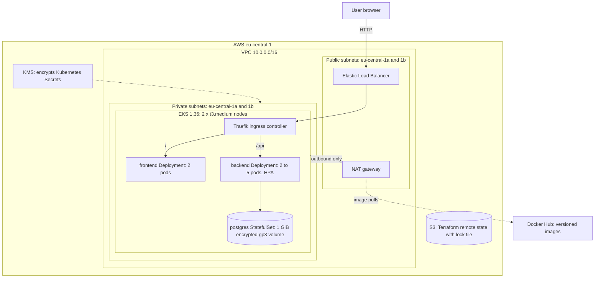

# Infrastructure Platform: Code to Cluster

A three-layer platform that provisions AWS infrastructure with Terraform, packages a three-tier web application with Docker, and runs it on Amazon EKS with Kubernetes. The application is a small task list: a static frontend, a Node.js API, and PostgreSQL.

Everything is reproducible from this repository, and every cloud resource is defined as code.

## Architecture



**Request flow:** browser → AWS load balancer → Traefik → frontend or backend Service → healthy pod. Only the load balancer is public. All workloads, including the database, run in private subnets with no inbound route from the internet.

## Repository structure

```
terraform/
  bootstrap/          S3 state bucket (separate lifecycle, never destroyed with the cluster)
  modules/
    networking/       VPC, public and private subnets across 2 AZs, NAT, routing
    security/         IAM roles, API security group, KMS key, EBS CSI Pod Identity role
    cluster/          EKS control plane, managed node group, add-ons
  main.tf             root module wiring the three modules, S3 backend
docker/
  frontend/           static page served by non-root nginx
  backend/            Node.js API
  database/           PostgreSQL with first-run init script
kubernetes/
  namespace.yaml
  frontend/           Deployment, Service
  backend/            Deployment, Service, ConfigMap, HPA
  database/           StatefulSet, headless Service, StorageClass, example Secret
  ingress/            Ingress rules
docs/screenshots/     testing evidence
```

## Prerequisites

| Tool | Version used |
|---|---|
| AWS CLI v2 | configured with an IAM user that can create VPC, EKS, IAM, KMS and S3 resources |
| Terraform | 1.15.6 (1.10 or later required for S3 lock files) |
| kubectl | matching EKS 1.36 |
| Helm | 3.18.1 |
| Docker | Docker Desktop |

Region: `eu-central-1` (Frankfurt). Estimated running cost: about US$0.30 per hour while the cluster exists (confirm with the AWS Pricing Calculator).

## Deployment guide

Run all commands from the repository root in a bash shell (Git Bash on Windows works).

### 1. Create the remote state bucket (once per AWS account)

```bash
cd terraform/bootstrap
terraform init
terraform apply
cd ..
```

The output `state_bucket_name` must match the `bucket` value in the `backend "s3"` block of `terraform/main.tf`. Update it if your account differs.

### 2. Provision the infrastructure

```bash
cp terraform.tfvars.example terraform.tfvars
# edit terraform.tfvars: set admin_cidrs to your public IP, e.g. ["x.x.x.x/32"]
# find it with: curl -s https://checkip.amazonaws.com

terraform init
terraform plan
terraform apply          # about 20 minutes
terraform plan           # must report "No changes" (idempotency check)
cd ..
```

### 3. Build and push images (optional, versions 1.x are already published)

```bash
docker build -t <user>/tasks-backend:1.1.0 docker/backend
docker build --build-arg APP_VERSION=1.0.0 -t <user>/tasks-frontend:1.0.0 docker/frontend
docker build -t <user>/tasks-db:1.0.0 docker/database
docker push <user>/tasks-backend:1.1.0   # repeat for each image
```

### 4. Connect kubectl and create the namespace and Secret

```bash
aws eks update-kubeconfig --region eu-central-1 --name capstone
kubectl apply -f kubernetes/namespace.yaml

mkdir -p secrets
openssl rand -base64 24 | tr -d '/+=\r\n' > secrets/db-password.txt
kubectl create secret generic db-credentials -n capstone \
  --from-literal=DB_USER=tasks \
  --from-file=DB_PASSWORD=secrets/db-password.txt
```

The real Secret is never written to Git. `secrets/` is in `.gitignore`, and `kubernetes/database/secret.example.yaml` shows its shape with fake values.

### 5. Deploy the application

```bash
kubectl apply -f kubernetes/database/storageclass.yaml -f kubernetes/backend/configmap.yaml
kubectl apply -f kubernetes/database/service.yaml -f kubernetes/database/statefulset.yaml
kubectl rollout status statefulset/postgres -n capstone

kubectl apply -f kubernetes/backend/deployment.yaml -f kubernetes/backend/service.yaml
kubectl apply -f kubernetes/frontend/deployment.yaml -f kubernetes/frontend/service.yaml
kubectl rollout status deployment/backend -n capstone
```

### 6. Install the ingress controller, then routing and autoscaling

```bash
helm repo add traefik https://traefik.github.io/charts
helm repo update
helm install traefik traefik/traefik -n traefik --create-namespace   # Traefik v3.7.14 used

kubectl apply -f kubernetes/ingress/ingress.yaml -f kubernetes/backend/hpa.yaml
```

### 7. Verify

```bash
LB=$(kubectl get svc traefik -n traefik -o jsonpath='{.status.loadBalancer.ingress[0].hostname}')
curl -s http://$LB/api/health/ready      # {"status":"ready"}
echo "Open http://$LB in a browser"
```

## Testing evidence

| Checklist item | Evidence |
|---|---|
| Backend dependencies have no known vulnerabilities | [01](docs/screenshots/01-npm-audit-backend.png) |
| Backend image under 150 MB (112 MB) | [02](docs/screenshots/02-backend-image-size.png) |
| Health checks defined, non-root user (backend) | [03](docs/screenshots/03-backend-health-nonroot.png) |
| Database image healthy | [04](docs/screenshots/04-database-healthy.png) |
| Backend and database work together locally | [05](docs/screenshots/05-backend-db-end-to-end.png) |
| Frontend under 150 MB (73.7 MB), version stamped, non-root | [06](docs/screenshots/06-frontend-size-version-nonroot.png) |
| Images pushed to a registry with version tags | [07](docs/screenshots/07-dockerhub-images.png) |
| Remote state bucket created | [08](docs/screenshots/08-state-bucket-created.png) |
| Terraform provisions networking and cluster resources | [09](docs/screenshots/09-terraform-apply.png) |
| `terraform plan` shows no changes after apply | [10](docs/screenshots/10-terraform-plan-no-changes.png) |
| All pods healthy on EKS | [11](docs/screenshots/11-backend-db-ready.png) |
| Application accessible via Ingress | [12](docs/screenshots/12-app-live-via-ingress.png) |
| Horizontal Pod Autoscaler active | [13](docs/screenshots/13-hpa-active.png) |
| Database data persists across pod restarts | [14](docs/screenshots/14-data-persists-after-restart.png) |
| Rolling update with zero downtime (0 failed requests) | [15](docs/screenshots/15-rolling-update-zero-downtime.png) |
| Cleanup instructions verified: all resources destroyed, no clusters remain | [16](docs/screenshots/16-teardown-complete.png) |

## Design decisions and trade-offs

| Decision | Why | Trade-off |
|---|---|---|
| Amazon EKS rather than kubeadm | AWS runs the control plane, so effort goes into the platform, not cluster plumbing | Control plane costs about US$0.10 per hour |
| EKS 1.36 with `upgrade_policy = STANDARD` | Supported until August 2, 2027, and mature enough for tooling. The policy stops the cluster drifting into extended support (US$0.60 per hour) | 1.37 is newer, but tooling sometimes lags the newest version |
| Three Terraform modules (networking, security, cluster) | Clean separation of concerns; each module has one job and is reusable | More files than a single flat configuration |
| `default_tags` on the AWS provider | Every resource gets identical tags for traceability and cost attribution, with no repetition | Tags apply only to resources Terraform creates, not to Kubernetes-created ones |
| Remote state in S3 with `use_lockfile` | Native S3 locking (Terraform 1.10+) removes the need for a DynamoDB table | Requires Terraform 1.10 or later |
| State bucket in a separate `bootstrap` root | The bucket outlives the cluster, so `terraform destroy` never deletes its own state. Versioned, encrypted, public access blocked, `prevent_destroy` | The bootstrap's own small state stays local |
| One NAT gateway instead of one per AZ | Saves about US$0.05 per hour per gateway | Outbound traffic depends on one AZ; production would use one per AZ |
| Public API endpoint restricted to the admin IP, plus a private endpoint | Only the operator's IP can reach the Kubernetes API publicly; nodes use the private endpoint | Admin IP changes require a `terraform apply` |
| Kubernetes Secrets encrypted with a dedicated KMS key | Envelope encryption protects Secrets at rest inside EKS, with key rotation enabled | Small KMS cost; key deletion has a 7-day waiting period |
| Secrets created from the command line, never committed | Kubernetes Secrets are only base64-encoded, so committing them would expose the password | Each operator creates the Secret manually (documented above) |
| EBS CSI driver on EKS Pod Identity | Only the disk controller gets disk permissions; the node role stays minimal. Required anyway, as node IMDS is not reachable from pods (hop limit 1) | One extra add-on (`eks-pod-identity-agent`) |
| Multi-stage images, runtime without npm | Smaller images and a smaller attack surface: no package manager for an attacker to use | Build stage downloads more on first build |
| Database image exempt from the 150 MB limit (393 MB) | The checklist limits frontend and backend images; the official PostgreSQL Alpine image is the secure, maintained base | Larger pull on first start |
| Docker Hub instead of Amazon ECR | Simple and free, with semantic version tags | ECR would keep images inside AWS and allow IAM-based pulls |
| Traefik instead of ingress-nginx | Kubernetes retired ingress-nginx in March 2026 and warned that continuing to run it leaves users exposed. Traefik is maintained and reads standard Ingress resources | Different annotations from ingress-nginx if advanced features are needed |
| One PostgreSQL pod (StatefulSet) | A single source of truth; safe multi-replica PostgreSQL needs replication | The database is a single point of failure, and its EBS volume is tied to one AZ. Production would use Amazon RDS Multi-AZ |
| Pod hardening via `securityContext` | Non-root UIDs, no privilege escalation, all Linux capabilities dropped, read-only root filesystem for frontend and backend | PostgreSQL keeps a writable root filesystem, as it needs working files outside its data directory |
| Rolling updates with `maxSurge: 1`, `maxUnavailable: 0` and a `preStop` hook | Capacity never drops, and pods keep serving while being removed from routing | Each rollout takes slightly longer (10 seconds per old pod) |
| HPA on CPU at 70% of the request | Scales the backend from 2 to 5 pods under load | Scales pods, not nodes; node autoscaling would need Cluster Autoscaler or Karpenter |
| Topology spread with `ScheduleAnyway` | Replicas spread across AZs where possible, but pods still run if spreading is impossible | Replicas can occasionally share an AZ |
| StorageClass `reclaimPolicy: Delete` | Deleting the claim deletes the disk, so nothing is left billing after cleanup | Production would use `Retain` to protect data |

## Troubleshooting log

Real issues found and fixed during the build:

1. **EBS CSI controller in CrashLoopBackOff.** Logs showed `no EC2 IMDS role found`. Pods cannot reach the node's instance metadata (hop limit 1). Fixed by giving the controller its own IAM role through EKS Pod Identity, and removing the disk policy from the node role.
2. **Backend readiness failing (`password authentication failed`).** The generated password ended with an invisible Windows carriage return (`\r`), which PostgreSQL stripped at initialisation but the backend did not. Found with `od -c`, fixed by stripping `\r`. The password command above now strips it.
3. **Backend crashed when the database restarted.** The `pg` pool raised an unhandled error event on dropped idle connections, which ends a Node.js process. Fixed in backend 1.1.0 with a pool error handler and readiness logging.
4. **One 504 during a rolling update (89 of 90 requests succeeded).** A race between pod shutdown and Traefik removing the pod from routing. A control test with no rollout returned 90 of 90, isolating the cause. Fixed with a 10-second `preStop` hook; the retest returned 0 failures.

## Cleanup

Kubernetes created a load balancer and an EBS volume that Terraform does not track. Remove them **first**, or `terraform destroy` fails on the VPC and the volume is left billing.

```bash
helm uninstall traefik -n traefik           # deletes the AWS load balancer
kubectl delete namespace capstone           # deletes the app and the PVC, which deletes the EBS volume
kubectl get pv                              # wait until this is empty

aws elb describe-load-balancers --region eu-central-1 \
  --query "LoadBalancerDescriptions[].LoadBalancerName"   # must be empty

cd terraform
terraform destroy
```

The state bucket in `terraform/bootstrap` is kept on purpose (`prevent_destroy`). To remove it as well, empty all object versions, remove the `prevent_destroy` block, then run `terraform destroy` in `terraform/bootstrap`.

## Future improvements

- HTTPS with TLS termination at Traefik (cert-manager) or an AWS Certificate Manager certificate.
- Separate `dev` and `prod` environments calling the same modules, with separate state files and AWS accounts.
- Amazon RDS Multi-AZ instead of an in-cluster database.
- A CI/CD pipeline (GitHub Actions) to build, scan and push images on every commit.
- Image vulnerability scanning (Trivy) and NetworkPolicies to restrict pod-to-pod traffic.
- Node autoscaling (Karpenter), monitoring (Prometheus and Grafana), and packaging the app as a Helm chart.