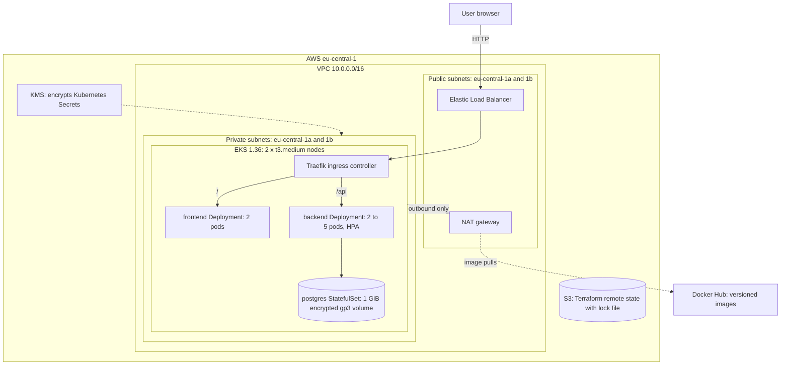

# Infrastructure Platform: Code to Cluster

A three-layer platform that provisions AWS infrastructure with Terraform, packages a three-tier web application with Docker, and runs it on Amazon EKS with Kubernetes. The application is a small task list: a static frontend, a Node.js API, and PostgreSQL.

Everything is reproducible from this repository, and every cloud resource is defined as code.

## Architecture



**Request flow:** browser → AWS load balancer → Traefik → frontend or backend Service → healthy pod. Only the load balancer is public. All workloads, including the database, run in private subnets with no inbound route from the internet.

## Repository structure

```
terraform/
  bootstrap/          S3 state bucket (separate lifecycle, never destroyed with the cluster)
  modules/
    networking/       VPC, public and private subnets across 2 AZs, NAT, routing
    security/         IAM roles, API security group, KMS key, EBS CSI Pod Identity role
    cluster/          EKS control plane, managed node group, add-ons
  main.tf             root module wiring the three modules, S3 backend
docker/
  frontend/           static page served by non-root nginx
  backend/            Node.js API
  database/           PostgreSQL with first-run init script
kubernetes/
  namespace.yaml
  frontend/           Deployment, Service
  backend/            Deployment, Service, ConfigMap, HPA
  database/           StatefulSet, headless Service, StorageClass, example Secret
  ingress/            Ingress rules
docs/screenshots/     testing evidence
```

## Prerequisites

| Tool | Version used |
|---|---|
| AWS CLI v2 | configured with an IAM user that can create VPC, EKS, IAM, KMS and S3 resources |
| Terraform | 1.15.6 (1.10 or later required for S3 lock files) |
| kubectl | matching EKS 1.36 |
| Helm | 3.18.1 |
| Docker | Docker Desktop |

Region: `eu-central-1` (Frankfurt). Estimated running cost: about US$0.30 per hour while the cluster exists (confirm with the AWS Pricing Calculator).

## Deployment guide

Run all commands from the repository root in a bash shell (Git Bash on Windows works).

### 1. Create the remote state bucket (once per AWS account)

```bash
cd terraform/bootstrap
terraform init
terraform apply
cd ..
```

The output `state_bucket_name` must match the `bucket` value in the `backend "s3"` block of `terraform/main.tf`. Update it if your account differs.

### 2. Provision the infrastructure

```bash
cp terraform.tfvars.example terraform.tfvars
# edit terraform.tfvars: set admin_cidrs to your public IP, e.g. ["x.x.x.x/32"]
# find it with: curl -s https://checkip.amazonaws.com

terraform init
terraform plan
terraform apply          # about 20 minutes
terraform plan           # must report "No changes" (idempotency check)
cd ..
```

### 3. Build and push images (optional, versions 1.x are already published)

```bash
docker build -t <user>/tasks-backend:1.1.0 docker/backend
docker build --build-arg APP_VERSION=1.0.0 -t <user>/tasks-frontend:1.0.0 docker/frontend
docker build -t <user>/tasks-db:1.0.0 docker/database
docker push <user>/tasks-backend:1.1.0   # repeat for each image
```

### 4. Connect kubectl and create the namespace and Secret

```bash
aws eks update-kubeconfig --region eu-central-1 --name capstone
kubectl apply -f kubernetes/namespace.yaml

mkdir -p secrets
openssl rand -base64 24 | tr -d '/+=\r\n' > secrets/db-password.txt
kubectl create secret generic db-credentials -n capstone \
  --from-literal=DB_USER=tasks \
  --from-file=DB_PASSWORD=secrets/db-password.txt
```

The real Secret is never written to Git. `secrets/` is in `.gitignore`, and `kubernetes/database/secret.example.yaml` shows its shape with fake values.

### 5. Deploy the application

```bash
kubectl apply -f kubernetes/database/storageclass.yaml -f kubernetes/backend/configmap.yaml
kubectl apply -f kubernetes/database/service.yaml -f kubernetes/database/statefulset.yaml
kubectl rollout status statefulset/postgres -n capstone

kubectl apply -f kubernetes/backend/deployment.yaml -f kubernetes/backend/service.yaml
kubectl apply -f kubernetes/frontend/deployment.yaml -f kubernetes/frontend/service.yaml
kubectl rollout status deployment/backend -n capstone
```

### 6. Install the ingress controller, then routing and autoscaling

```bash
helm repo add traefik https://traefik.github.io/charts
helm repo update
helm install traefik traefik/traefik -n traefik --create-namespace   # Traefik v3.7.14 used

kubectl apply -f kubernetes/ingress/ingress.yaml -f kubernetes/backend/hpa.yaml
```

### 7. Verify

```bash
LB=$(kubectl get svc traefik -n traefik -o jsonpath='{.status.loadBalancer.ingress[0].hostname}')
curl -s http://$LB/api/health/ready      # {"status":"ready"}
echo "Open http://$LB in a browser"
```

## Testing evidence

| Checklist item | Evidence |
|---|---|
| Backend dependencies have no known vulnerabilities | [01](docs/screenshots/01-npm-audit-backend.png) |
| Backend image under 150 MB (112 MB) | [02](docs/screenshots/02-backend-image-size.png) |
| Health checks defined, non-root user (backend) | [03](docs/screenshots/03-backend-health-nonroot.png) |
| Database image healthy | [04](docs/screenshots/04-database-healthy.png) |
| Backend and database work together locally | [05](docs/screenshots/05-backend-db-end-to-end.png) |
| Frontend under 150 MB (73.7 MB), version stamped, non-root | [06](docs/screenshots/06-frontend-size-version-nonroot.png) |
| Images pushed to a registry with version tags | [07](docs/screenshots/07-dockerhub-images.png) |
| Remote state bucket created | [08](docs/screenshots/08-state-bucket-created.png) |
| Terraform provisions networking and cluster resources | [09](docs/screenshots/09-terraform-apply.png) |
| `terraform plan` shows no changes after apply | [10](docs/screenshots/10-terraform-plan-no-changes.png) |
| All pods healthy on EKS | [11](docs/screenshots/11-backend-db-ready.png) |
| Application accessible via Ingress | [12](docs/screenshots/12-app-live-via-ingress.png) |
| Horizontal Pod Autoscaler active | [13](docs/screenshots/13-hpa-active.png) |
| Database data persists across pod restarts | [14](docs/screenshots/14-data-persists-after-restart.png) |
| Rolling update with zero downtime (0 failed requests) | [15](docs/screenshots/15-rolling-update-zero-downtime.png) |